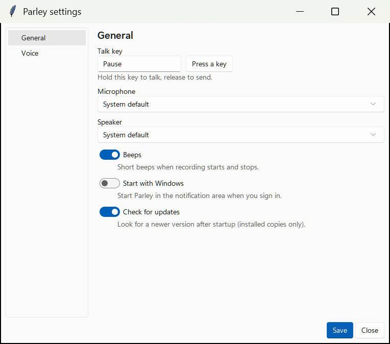

# Parley

A push-to-talk voice assistant that runs on your own machine. Hold a key, talk, let go, and a
local LLM answers out loud. By default speech recognition, the LLM and the voice all run on your
PC, with no accounts. Only web search and page fetches go online (see [Privacy](#privacy)).

<picture>
  <source media="(prefers-color-scheme: dark)" srcset="docs/images/settings-general-dark.png">
  
</picture>

Status: version 0.1.0, an early release. Windows 10/11 is the only tested platform.

```
hold key ──► mic ──► Whisper (GPU) ──► local LLM (streaming) ──► Kokoro TTS ──► speakers
                                              │                        ▲
                                              └── sentence by sentence ┘
```

## Features

- Hold-to-talk (default key **Pause**); press it again to interrupt an answer.
- Fast: models stay loaded, the mic is always open with a short pre-roll, and the answer is spoken
  sentence by sentence while the LLM is still generating.
- Runs locally by default (speech recognition, LLM, voice); optional Anthropic or OpenAI backend for smarter answers.
- Can act on your computer: read what is in a File Explorer folder, read a file, find and open
  files, folders, websites and Start menu apps, and search the web.
- Windows tray app with a Settings window (talk key, microphone, speaker, voice and speed, start with Windows).
- Uses an NVIDIA GPU when there is one; runs fine on CPU-only laptops.

See the [usage guide](docs/USAGE.md) for details.

## Install on Windows

1. Download `Parley-Setup-<version>.exe` from the
   [latest release](https://github.com/ChrisLPJones/parley-ai-assistant/releases/latest).
2. Run it. It installs for your user only (no administrator rights) to `%LOCALAPPDATA%\Programs\Parley`
   and adds a Start menu entry.
3. The installer is **not code-signed yet**, so Windows SmartScreen shows "Windows protected your PC".
   Choose **More info**, then **Run anyway**.
4. Start Parley from the Start menu. It runs in the notification area. The first run downloads the
   speech, language and voice models, **several GB**, with progress shown; later starts take a few
   seconds and work offline.

An NVIDIA GPU is optional. With one, Parley downloads about 1.6 GB of CUDA libraries once, in the
background, and uses the GPU from the next start. You do not need the CUDA toolkit.

Running a newer installer upgrades in place. Uninstalling removes the program but keeps your data
(models, settings, GPU libraries) in `%LOCALAPPDATA%\parley`; delete that folder to remove everything.
Logs are in `%LOCALAPPDATA%\parley\logs\parley.log`.

## Run from source on Windows

Needs Windows 10 or 11, [uv](https://docs.astral.sh/uv/) and a microphone.

```sh
git clone https://github.com/ChrisLPJones/parley-ai-assistant
cd parley-ai-assistant
uv run parley
```

Wait for "Ready. Hold [pause] and speak; release to send. Ctrl+C to quit." in the console. Use
`uv run parley --tray` for the notification-area version. More commands and building the installer:
[docs/BUILDING.md](docs/BUILDING.md).

## Run manually on Linux (experimental, untested)

Linux support has not been tested. Nothing here is known to work. To try it from source:

```sh
# Ubuntu: sudo apt install libportaudio2      Fedora: sudo dnf install portaudio
git clone https://github.com/ChrisLPJones/parley-ai-assistant
cd parley-ai-assistant
uv run parley
```

Expect problems:

- The global hotkey needs an X11 session; under Wayland it will likely fail.
- `pywin32` is a Windows-only dependency, and the Windows-only features (Explorer "this folder" and selection, GPU detection) are unavailable.
- Known open issues: the pip-installed CUDA libraries may not be found, because Parley extends `PATH` but not `LD_LIBRARY_PATH`; the pynput win32 filter is unverified on Linux; the Linux llama.cpp assets were checked against the release listing and hashed (Ubuntu Vulkan x64) but never run.

## Requirements and hardware

- Windows 10 or 11, a microphone, speakers or headphones, and disk space for several GB of models.
- Optional: an NVIDIA graphics driver for GPU speed and the more accurate speech model.

| Hardware | Status |
|---|---|
| NVIDIA GPU | tested (RTX 5090) |
| Discrete AMD GPU | design only, not tested |
| Discrete Intel GPU (Arc) | **unverified** |
| Integrated GPU only, or no GPU (CPU) | AMD tested; Intel **unverified** |

Parley never fails because of a GPU: it falls back to the CPU. Details and which stage runs where:
[docs/CONFIGURATION.md](docs/CONFIGURATION.md#which-hardware-is-used).

## Privacy

By default speech recognition, the LLM and the voice run locally. Only web search (DuckDuckGo) and
page fetches go online; they are on by default and `web_search = false` under `[tools]` turns them
off. Models are downloaded on first run. If you choose the Anthropic or OpenAI backend, **only the
transcribed text and tool output leave your machine** (never audio), including anything a tool reads for the
conversation, such as the contents of a file you asked about. API keys are kept in the Windows
credential store, never in a file. Tools are read-only except opening things, and files that may hold
secrets (SSH keys, `.env`, credential stores) are off limits.

## More

- [Usage guide](docs/USAGE.md)
- [Configuration](docs/CONFIGURATION.md)
- [Building and packaging](docs/BUILDING.md)
- [Roadmap](ROADMAP.md)

## Contributing and issues

Bug reports and ideas are welcome as [GitHub issues](https://github.com/ChrisLPJones/parley-ai-assistant/issues).
Please include the relevant lines from `parley.log` (check them for anything private first).

## Licence

MIT
