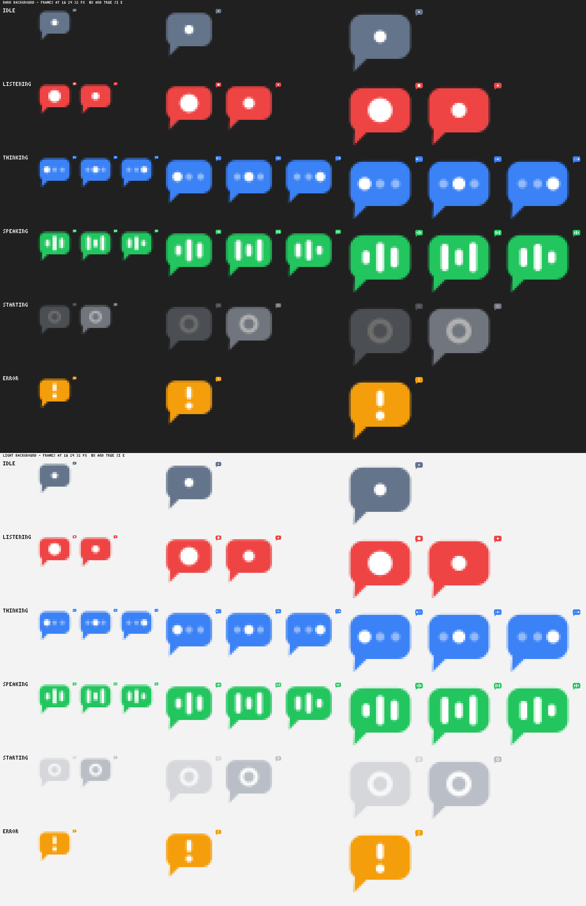
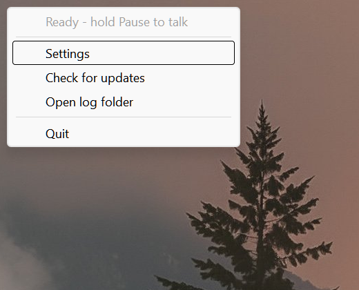
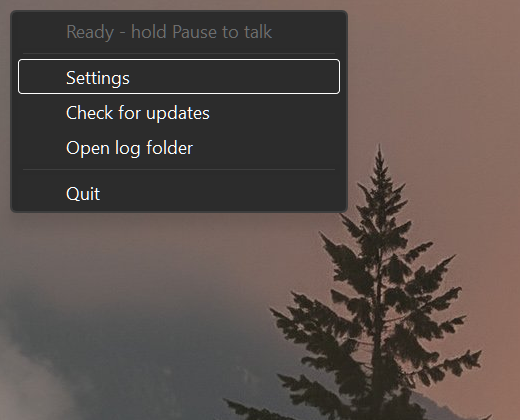
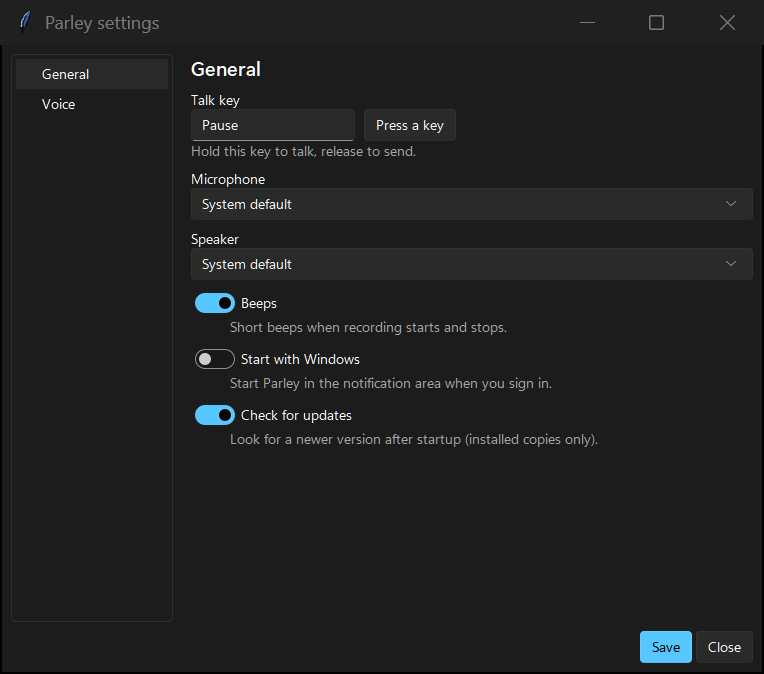
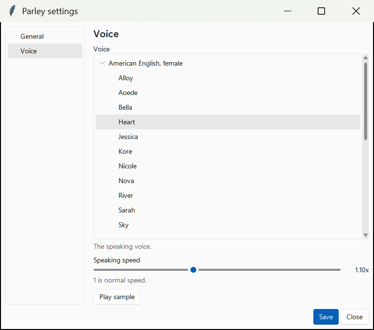
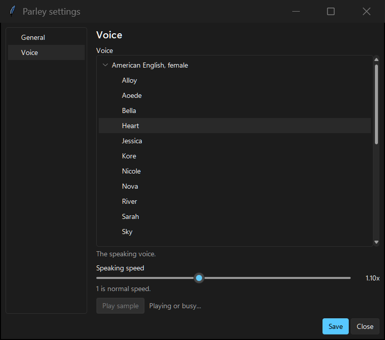

# Using Parley

## First start

Start Parley from the Start menu (see the [install steps](../README.md#install-on-windows)). The
first run downloads several GB of models; the tray icon shows a grey ring and its tooltip and menu
show the download progress. When it is ready the menu says "Ready - hold Pause to talk", and on the very first start
Parley also speaks a short welcome: how to use the talk key, and to right-click the Parley icon in the notification
area and choose Settings to change anything. It is not repeated on later starts.

On an NVIDIA GPU, Parley also downloads about 1.6 GB of CUDA libraries once, in the background. It
keeps working on the CPU meanwhile; when the download is done and Parley is idle it restarts itself once in the
background to use the GPU.

## The tray icon

Parley lives in the notification area (you may need to expand the hidden icons). The icon is a
speech bubble whose colour and symbol show what Parley is doing:

| State | Look | Meaning |
|---|---|---|
| Idle | grey bubble, white dot | Ready, waiting for you |
| Listening | red bubble, pulsing dot | Recording while you hold the talk key |
| Thinking | blue bubble, three moving dots | Transcribing and generating the answer |
| Speaking | green bubble, moving bars | Reading the answer aloud |
| Starting | grey bubble, ring | Starting up or downloading models |
| Error | orange bubble, exclamation mark | Something went wrong; open the log folder |

<picture>
  <source media="(prefers-color-scheme: dark)" srcset="images/tray-icon-states.png">
  
</picture>

(The picture shows each state at several sizes on a dark and a light background; the small text in
it is only a sheet label.)

Left-click the icon, or choose **Settings**, to open the Settings window. Right-click for the menu:

| Light | Dark |
|---|---|
|  |  |

The menu shows the current status, then **Settings**, **Check for updates** (available in installed
copies), **Open log folder** and **Quit**.

## Talking

1. Hold the talk key (default **Pause**) and speak. Short beeps (optional) mark the start and end.
2. Release the key to send.
3. Press the key again while Parley is talking to interrupt it; a new recording starts at once.

## What you can ask

Besides answering questions, Parley can act on your computer and look things up:

- **"What's in here?" / "How many files are in this folder?"** with File Explorer open (counts, sizes, file types)
- **"Read this"** with a file selected in Explorer, or "read notes.txt in Downloads"
- **"Find my CV"**, **"Open Downloads"**, **"Open Spotify"**, **"Open youtube.com"**
- **"What's the weather in Auckland?"** or anything current, via web search

"This" and "here" mean the folder and selection in the File Explorer window you're using.
Everything is read-only except opening things, and Parley only opens folders, a fixed list of
document, image, audio and video file types, websites and Start menu apps, never scripts or
programs by path. Network paths (`\\server\share`) are refused, web pages on your own machine or
network are never fetched, and files that may hold secrets (SSH keys, `.env`, credential stores,
Parley's own `config.toml`) are off limits. Turn tools off with `[tools] enabled = false` in
`config.toml` (see [Configuration](CONFIGURATION.md)).

## The Settings window

Most changes apply at once. When one needs a restart, the window says so and offers **Restart now**.
Use **Save** to apply and **Close** to leave.

**General**

| Light | Dark |
|---|---|
|  |  |

- **Talk key:** click **Press a key** and press the key you want.
- **Microphone** and **Speaker:** pick a device, or leave "System default".
- **Beeps:** short beeps when recording starts and stops.
- **Start with Windows:** start Parley in the notification area when you sign in (installed copies only).
- **Check for updates:** look for a newer version after startup (installed copies only); Parley asks before installing.

**Voice**

| Light | Dark |
|---|---|
|  |  |

Pick a voice from the list (grouped by accent and gender), set the speaking speed (1 is normal) and
press **Play sample** to hear it.

**Models**

Lists every model Parley knows about (speech recognition, language model and voice) with its size, whether it is
installed or in use, and how well it should run on your computer (a word and a symbol: fits your GPU, slower, or too
big). The one Parley recommends for your hardware is marked "recommended". Nothing is hidden: a model that looks too big
can still be tried, at your own risk.

- **Download:** fetches the selected model and checks it. A bar shows the progress; **Cancel** stops it and keeps what
  was downloaded so the next download continues. One download runs at a time, and it carries on if you close Settings.
- **Use:** chooses a language model. Press **Save**: Parley loads it in the background and switches when it is ready (the
  previous one keeps answering until then). If you set your own model (a custom repo, file or path), this replaces that
  setting when you press **Save**.
- **Delete:** removes a downloaded model after you confirm. The model in use can't be deleted.

**LLM**

Where answers come from: **Built-in** (the model chosen on the Models page), **Ollama**, **your own server**
(OpenAI-compatible), **OpenAI** or **Anthropic Claude**. The page shows only the settings that apply to the backend you
pick: the model name, the server address, Claude's effort, the context size, and under **Behavior** the computer tools,
web search, the system prompt, temperature and how many exchanges are remembered.

- **Save** reloads the language model without restarting Parley, while it is idle (during an answer the change waits for
  the end). The new one starts in the background and replaces the old one only when it works; if it cannot start, the
  banner says why in one sentence and the previous model keeps answering. The conversation starts fresh after a switch.
- **Cloud backends:** the page says in one line that your speech is still turned into text on this computer but that the
  text, and anything the tools read or find, is sent to the provider.
- **API key (OpenAI, Anthropic):** the page shows only whether a key is saved. Type or paste a key and press **Save key**
  (**Replace key** when one exists): it goes into the Windows credential store and the box is emptied; it is never put in
  `config.toml` and a saved key is never shown again. **Remove** deletes it (after you confirm). **Test key** sends one
  request to the provider's own site to check the key; nothing is sent until you press it. If `ANTHROPIC_API_KEY` /
  `OPENAI_API_KEY` is set and no key is saved, that is used and the page says so. A key for your own server, if it needs
  one, stays in `config.toml` (`api_key` under `[llm]`).
- **Server address:** an address starting with `http://` (not on this computer) shows a warning, because what you say and
  any key travel unencrypted. For OpenAI a different host than OpenAI's own is flagged as well.

## Cloud backends and API keys

By default everything runs locally. For smarter answers you can use Anthropic or OpenAI for the LLM
step; speech recognition and the voice stay local, and only transcribed text and tool output are
sent. Choose the backend and save the key on the **LLM** page of Settings (above), or from a terminal:

```
parley --set-key anthropic
```

(or `openai`; what you type is hidden). The key goes into the Windows credential store, not a file.
`parley --key-status` shows what is saved and `parley --delete-key anthropic` removes it. For an
installed copy run these through `parley-app.exe` in `%LOCALAPPDATA%\Programs\Parley\app\<version>\`.
More in [Configuration](CONFIGURATION.md#cloud-backends).

## Changing the talk key on laptops without Pause

Most laptops have no Pause key. Open Settings, **General**, click **Press a key** and press another
key, for example F13, Scroll Lock or Right Ctrl. Alternatively set `[hotkey] key = "f13"` (or
`"scroll_lock"`, `"ctrl_r"`) in `config.toml`.

## Troubleshooting

- **Nothing happens when you speak:** check the talk key and your microphone in Settings. From a
  terminal, `parley --test-mic` tests the mic and `parley --list-devices` lists devices.
- **Garbled or nonsense answers on a GPU without a crash (for example Vulkan):** set `runtime = "cpu"` under `[llm]`.
- **Orange error icon or Parley will not start:** choose **Open log folder** from the tray menu.
- **Windows warns about the installer:** it is unsigned; see the [install steps](../README.md#install-on-windows).

## Logs

The tray app writes `%LOCALAPPDATA%\parley\logs\parley.log` (menu: **Open log folder**). The local LLM
writes `llama-server.log` in the same folder. Run from source with `-v` for debug logging and
latency timings.

## Updates

Installed copies look for a newer version after startup and ask before installing; **Check for
updates** in the tray menu checks on demand, and Settings can turn the check off. Running a newer
installer also upgrades in place. Your models and settings are never touched by an update or an uninstall.
